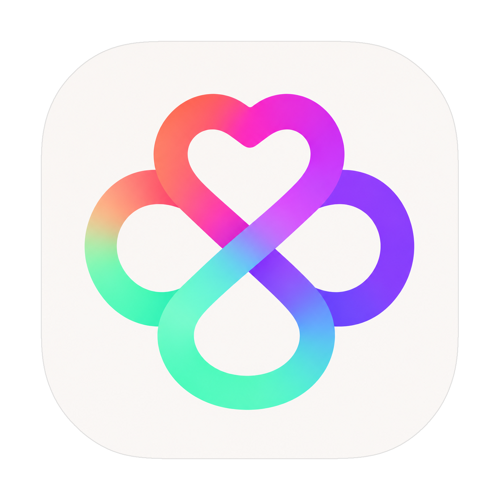
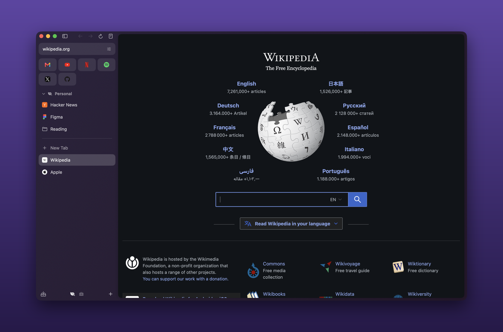
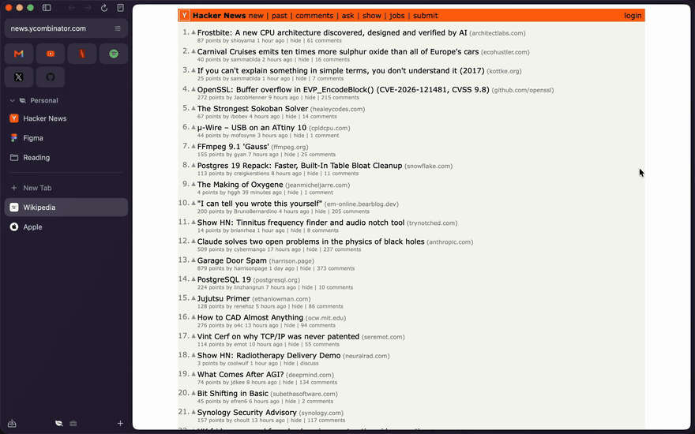
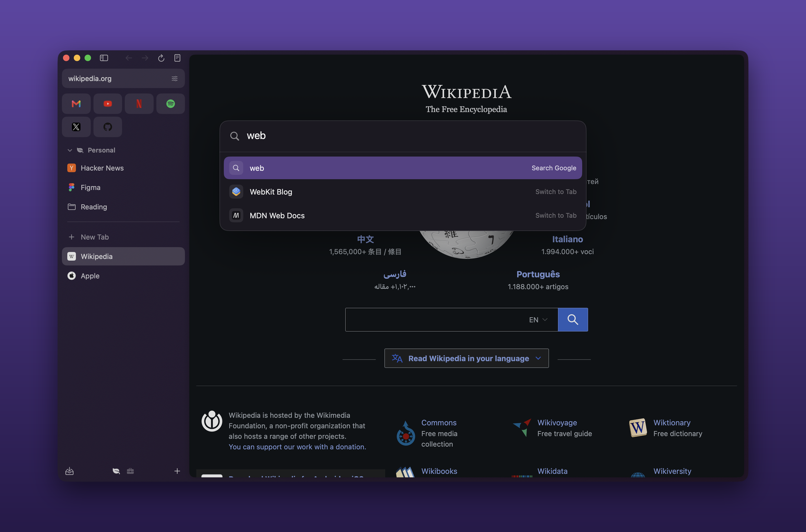
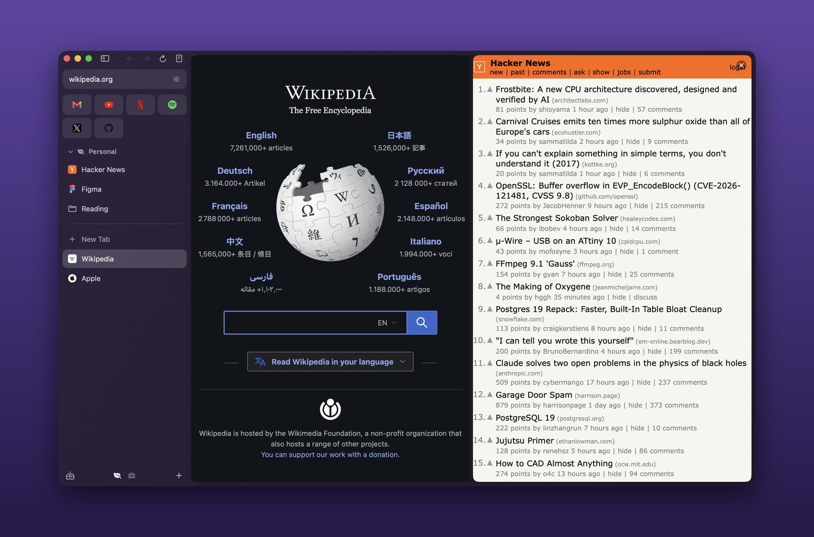
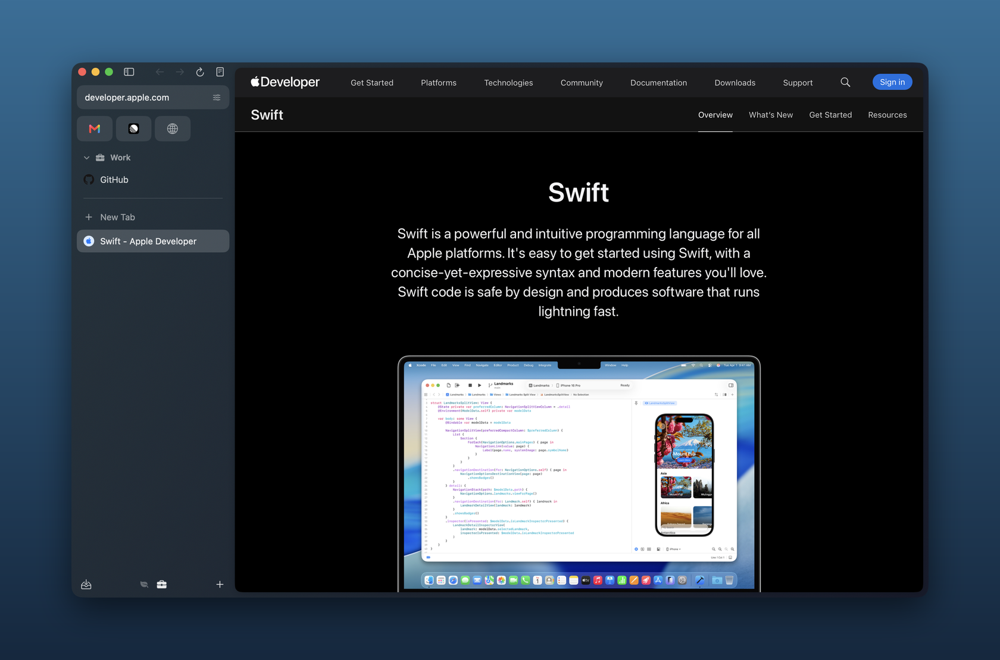
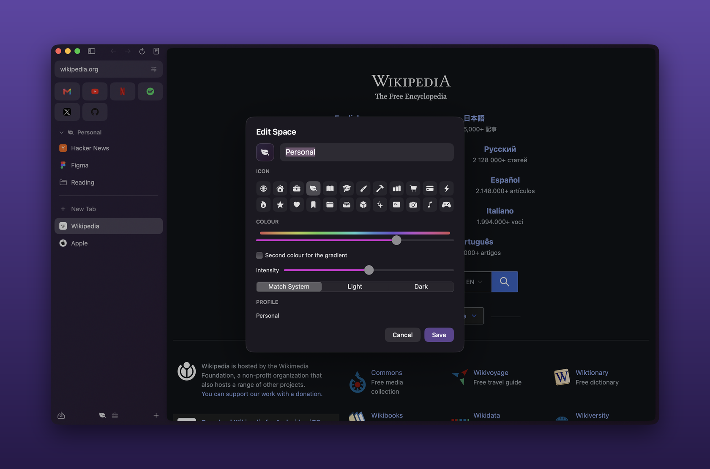
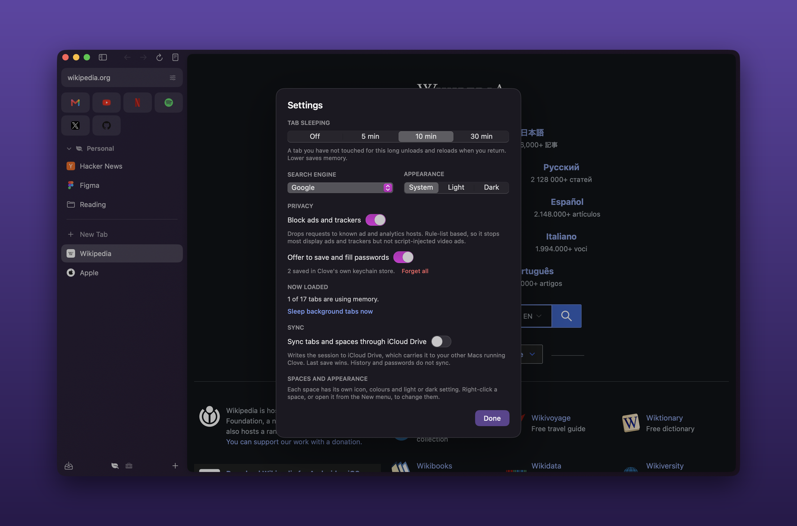
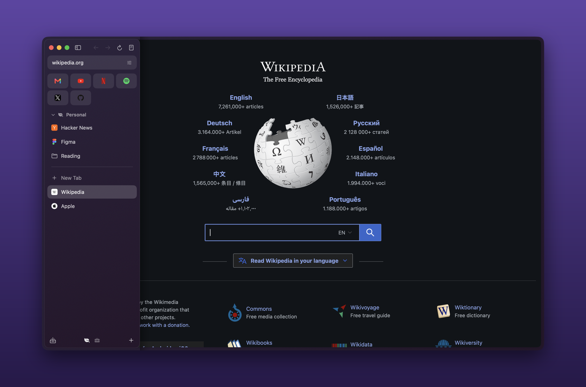
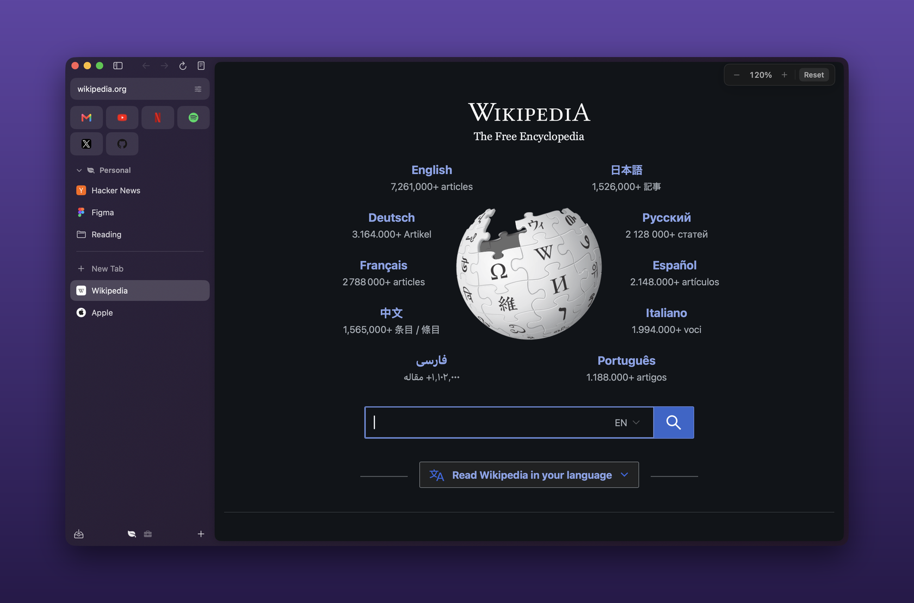

<p align="center">
  
</p>

# Clove

Safari's engine, with the tab, bookmark and profile management Safari lacks.

Clove is a native Mac browser built on WebKit, the same engine Safari uses. Pages load and render
the way they do in Safari, and they use about the same power. What changes is everything around
the page: a sidebar that keeps tabs and bookmarks in order, spaces for separate parts of your day,
and profiles that keep work and personal logins apart.



[Download Clove for Mac](https://github.com/thedesignmvp/Clove-Browser/releases/latest). The DMG is
3 MB, signed and notarized by Apple, and needs macOS 14 or later.

## A quick tour

The command bar, tab switching, spaces, split view, the floating sidebar and Settings, in 25 seconds.



## Why not just Safari

Safari is fast and easy on the battery, and it gets unwieldy past twenty tabs. Clove keeps the first
part and fixes the second.

### Tabs

- Tabs live in a vertical sidebar, so you read full titles, not slivers.
- Pinned tabs stay put. Today's tabs sit below them and are easy to clear.
- Drag tabs to reorder them, into folders, or onto another space.
- Cmd+T opens a command bar that searches open tabs, history and the web from one field.
- An active-tabs view lists everything open, and works from the keyboard alone.
- Split view shows two pages side by side. A mini window opens a link without losing your place.





### Bookmarks

- Favorites sit in a grid at the top of the sidebar, one click away.
- Pinned tabs work as bookmarks that remember where you left off.
- Folders nest, and collapse when you want them out of sight.

### Profiles and spaces

- A space has its own name, icon, colours and set of tabs. Swipe two fingers on the sidebar to move between them.
- A profile has its own cookies and logins. Give a space its own profile, or share one across several.
- Sign in to two accounts on the same site, one per profile, with no private windows.





### Light on memory and battery

- WebKit is the engine Apple tunes for Mac hardware, so Clove gets Safari's power use for page work.
- Background tabs unload after an idle timeout you choose, and reload when you click them.
- The built-in blocker stops ads and trackers before they load, which cuts network and CPU work.
- The app itself is small: about 6,000 lines of Swift, no Electron, no bundled engine.



## More

- Import from Arc: spaces, themes, icons, profiles, favorites, pinned tabs, folders and history.
- A password manager that saves logins to the Mac keychain and fills them in.
- Reader mode, find on page, per-site zoom and picture in picture.
- Downloads with progress and show-in-Finder.
- Userscripts, for custom JavaScript on the sites you pick.
- Session sync through iCloud Drive.
- Automatic updates.
- Native full screen, a floating sidebar, and Safari's Web Inspector.

| The sidebar hides and floats in when you need it | Zoom shows the percentage and a reset |
|---|---|
|  |  |

## Shortcuts

| Keys | Action |
|---|---|
| Cmd+T | New tab, and the command bar |
| Cmd+L | Edit the current address |
| Cmd+W | Close tab |
| Cmd+S | Show or hide the sidebar |
| Cmd+D | Pin or unpin tab |
| Cmd+F | Find on page |
| Cmd+Shift+C | Copy the page address |
| Cmd+Shift+R | Reader mode |
| Cmd+Shift+P | Picture in picture |
| Cmd+Shift+O | Open the page in a mini window |
| Cmd+plus, minus, 0 | Zoom in, zoom out, actual size |
| Cmd+Option+Up, Down | Previous or next tab |
| Cmd+Option+Left, Right | Previous or next space |
| Ctrl+1 to Ctrl+9 | Jump to a space |
| Cmd+Shift+N | New folder |
| Cmd+Ctrl+N | New space |
| Cmd+Ctrl+F | Full screen |
| Cmd+Option+I | Web Inspector |

## Known gaps

- Passkeys do not work yet. Apple has to grant a browser entitlement first, and the request is in. Sign in with a password and a 2-step code for now.
- Clove cannot read passwords saved in Apple's Passwords app. Apple reserves those for Safari. Clove fills only the logins you save in Clove.
- No Safari or Chrome extensions. Userscripts cover simple cases.
- Sync covers the session only, not history or passwords, and the newest save wins.
- Sites that need Widevine DRM will not play video. WebKit supports FairPlay only.
- Chrome DevTools cannot attach, because the engine is WebKit.

## Build from source

You need macOS 14 or later and the Xcode Command Line Tools. Xcode itself is not required.

```sh
git clone https://github.com/thedesignmvp/Clove-Browser.git
cd Clove-Browser
./build.sh
open build/Clove.app
```

## Releasing

`build.sh` signs with a Developer ID Application certificate when the keychain has one, and falls
back to an ad hoc signature when it does not.

To cut a release:

1. Bump `VERSION`, commit, and push.
2. Tag it: `git tag v$(cat VERSION) && git push --tags`.

The Release workflow then builds, signs, notarizes, packs the DMG, signs it for Sparkle, and
publishes a GitHub release with the DMG and `appcast.xml`. Installed copies find the update
through that appcast.

The workflow reads six repository secrets: `DEVELOPER_ID_P12` (the certificate, base64),
`DEVELOPER_ID_P12_PASSWORD`, `APPLE_ID`, `APPLE_TEAM_ID`, `APPLE_APP_PASSWORD` (an app-specific
password), and `SPARKLE_PRIVATE_KEY`.

To build a release on your own Mac, store the notary login once, then run the script:

```sh
xcrun notarytool store-credentials clove-notary --apple-id <id> --team-id <team> --password <app-specific>
scripts/release.sh
```

## Where things are

- `Sources/Clove/Models.swift` holds tabs, folders, profiles and spaces.
- `Sources/Clove/Store.swift` is the app state: selection, drag and drop rules, spaces, idle unloading.
- `Sources/Clove/Session.swift` reads and writes the session file, and upgrades the older format.
- `Sources/Clove/ArcImport.swift` reads Arc's sidebar file.
- `Sources/Clove/Sidebar.swift` is the sidebar.
- `Sources/Clove/Panels.swift` is the space editor, the import screen and Settings.
- `Sources/Clove/ContentView.swift` is the window layout and the page card.
- `Sources/Clove/CommandBar.swift` is the command bar.
- `Sources/Clove/main.swift` is the app start, the menu and the diagnostic flags.

The session is stored at `~/Library/Application Support/Clove/session.json`.

[PLAN.md](PLAN.md) tracks what is built and what is left.

## Licence

MIT. See [LICENSE](LICENSE).
